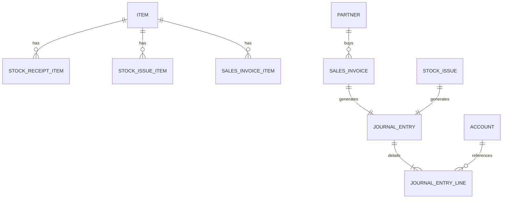

# 📘 PROJECT MASTER: ERPm - HỆ THỐNG KẾ TOÁN & QUẢN TRỊ BÁN HÀNG TỒN KHO HYBRID

> **Tài liệu chuẩn kiến trúc & Quy tắc phát triển phần mềm dành cho Developers và AI Agents.**  
> Mọi thay đổi, bổ sung code trong dự án **bắt buộc tuân thủ** các quy tắc trong tài liệu này.

---

## 1. TỔNG QUAN & TẦM NHÌN DỰ ÁN

### 1.1. Mục tiêu sản phẩm
Xây dựng một hệ thống phần mềm **Quản trị Bán hàng - Tồn kho - Kế toán (ERP mini)**:
- **Khởi đầu tinh gọn (Lean MVP):** Tập trung sâu vào luồng nghiệp vụ thực tế: **Bán hàng, Quản lý Tồn kho, Danh mục Sản phẩm (ITEM), Quản lý Khách hàng / Nhà cung cấp, Báo cáo & Dashboard**.
- **Khả năng mở rộng bền vững (Built-to-Scale):** Thiết kế nền tảng dữ liệu theo nguyên lý **Bút toán kép (Double-Entry Bookkeeping)** và **Event/Document Posting** ngay từ ngày đầu. Khi nâng cấp lên Kế toán tài chính đầy đủ (Sổ cái, Bảng cân đối phát sinh, Báo cáo lưu chuyển tiền tệ, TT200/TT133) **không phải đập đi xây lại cấu trúc CSDL**.
- **Đa nền tảng Hybrid (Web Desktop + Mobile App):**
  - **Desktop Web:** Phục vụ kế toán, quản lý, thao tác biểu mẫu lớn, bảng dữ liệu biểu đồ, xuất nhập Excel.
  - **Mobile / Tablet (iOS & Android):** Phục vụ nhân viên bán hàng (POS), nhân viên kho quét Barcode/QR Code, chủ doanh nghiệp xem dashboard di động.

### 1.2. Tech Stack Cốt Lõi
| Thành phần | Công nghệ được chọn | Lý do & Vai trò |
| :--- | :--- | :--- |
| **Backend API** | **C# / .NET 10 (LTS)** | Hiệu năng cao, Type-safe mạnh, Clean Architecture, dễ bảo trì enterprise. |
| **Database** | **PostgreSQL 16+** | Hỗ trợ JSONB linh hoạt, ACID chuẩn xác cho tài chính, miễn phí, hỗ trợ mở rộng partitioning sau này. |
| **ORM & Data Access** | **EF Core 10 + Dapper** | EF Core cho nghiệp vụ Command/Transaction; Dapper cho Query báo cáo & Dashboard tốc độ cao. |
| **Frontend Framework** | **Angular 18+ (Standalone Components)** | Cấu trúc module rõ ràng, Dependency Injection, Signals phản ứng nhanh, Type-safe tuyệt đối. |
| **Hybrid UI Framework** | **Ionic Framework 8 + Capacitor** | Bộ UI tối ưu đồng thời cho Mobile & Desktop Web, tích hợp Camera quét mã vạch native, Single Codebase build Android/iOS. |
| **Kiến trúc Mã nguồn** | **Clean Architecture (Domain-Driven)** | Tách biệt hoàn toàn Domain Logic, Application Layer, Infrastructure và Presentation. |

---

## 2. QUY CHUẨN KIẾN TRÚC BACKEND (.NET 10)

### 2.1. Cấu trúc Solution (Clean Architecture)
```text
ERPm/
├── src/
│   ├── ERPm.Domain/                  # Core Entities, Enums, Value Objects, Domain Events (Không phụ thuộc tầng ngoài)
│   │   ├── Common/                   # BaseEntity, IAuditable, ISoftDelete, ITenant
│   │   ├── Entities/Catalog/         # Item, UnitOfMeasure, Category, PriceList
│   │   ├── Entities/Partner/         # Partner (Customer/Supplier), Contact
│   │   ├── Entities/Sales/           # SalesOrder, SalesInvoice, SalesInvoiceItem
│   │   ├── Entities/Inventory/       # Warehouse, StockReceipt, StockIssue, StockBalance
│   │   └── Entities/Accounting/      # Account (Hệ thống TK), JournalEntry, JournalEntryLine
│   │
│   ├── ERPm.Application/             # Use Cases, CQRS/Service Layer, DTOs, Mappers, Validators
│   │   ├── Common/                   # Interfaces (IDbContext, ICurrentUserService, IDateTime)
│   │   ├── Features/Catalog/         # Items CRUD, Category tree
│   │   ├── Features/Sales/           # Lập đơn, Xuất hóa đơn, Tính tiền, Trừ kho
│   │   ├── Features/Inventory/       # Nhập kho, Xuất kho, Kiểm kê, Tính giá vốn
│   │   ├── Features/Partners/        # Khách hàng, NCC, Theo dõi công nợ
│   │   └── Features/Dashboard/       # Dapper Queries tính doanh số, tồn kho, top bán chạy
│   │
│   ├── ERPm.Infrastructure/          # EF Core DbContext, Migrations, Npgsql, Auth, Services ngoài
│   │   ├── Persistence/              # ApplicationDbContext, Configurations (Fluent API)
│   │   ├── Repositories/             # Implement repositories / Query handlers
│   │   └── Services/                 # BarcodeService, ExcelExportService, SystemDateTime
│   │
│   └── ERPm.API/                     # ASP.NET Core Web API, Controllers/Endpoints, Middleware
│       ├── Controllers/              # RESTful API Controllers
│       ├── Middlewares/              # ExceptionHandlingMiddleware, LoggingMiddleware
│       └── Extensions/               # Dependency Injection extensions
```

### 2.2. Quy tắc Code C# (.NET)
1. **Naming Conventions:**
   - Class, Interface, Method, Property: `PascalCase`.
   - Private field: `_camelCase`.
   - Interface luôn bắt đầu bằng chữ `I` (vd: `IItemRepository`, `IUnitOfWork`).
   - DTOs đặt tên rõ nghĩa theo hành vi: `CreateItemRequest`, `ItemDetailResponse`, `SalesInvoiceFilterQuery`.
2. **Entity Standards (Dual-Key Architecture):**
   - Mọi Entity chính kế thừa từ `BaseAuditableEntity` (và các bảng chi tiết kế thừa `BaseEntity`):
     - `Id` (`int` tự tăng - `GENERATED BY DEFAULT AS IDENTITY`): Dùng làm **Primary Key (PK)** và **Foreign Key (FK)** cho toàn bộ `JOIN` nội bộ, Dapper Query và các API `GET`/`PUT`/`DELETE` nội bộ.
     - `ExternalId` (`Guid` chuẩn **UUIDv7** sắp xếp theo thời gian RFC 9562): Tự động sinh qua `Uuid7Generator.NewUuid7()` phục vụ đồng bộ Offline Mobile, tích hợp đối ngoại và bảo mật URL khi cần. Được đánh **Unique Covering Index** (`CREATE UNIQUE INDEX ... ON (external_id) INCLUDE (id, is_deleted) WITH (fillfactor = 95)`) để đạt *Index-Only Scan* và chống phân mảnh B-Tree.
     - `CreatedAtUtc`, `CreatedBy`, `LastModifiedAtUtc`, `LastModifiedBy`.
     - `IsDeleted` (Soft-delete mặc định cho toàn bộ chứng từ & danh mục).
     - `CompanyId` / `TenantId` (`int?` sẵn sàng mở rộng đa chi nhánh / đa công ty).
3. **Immutability trong Kế toán & Kho:**
   - **Tuyệt đối không xóa cứng (Hard Delete)** các bản ghi hóa đơn, phiếu nhập/xuất kho đã ghi sổ (`Status = Posted`).
   - Mọi điều chỉnh đều phải thông qua **Phiếu hủy (Cancel)**, **Bút toán đảo (Storno/Reversal)**, hoặc **Phiếu điều chỉnh**.
4. **Code Comments & Documentation Standards:**
   - **Bắt buộc 100% bằng Tiếng Anh (English comments only):** Toàn bộ comment trong mã nguồn (C# backend, TypeScript/HTML/SCSS frontend, SQL migration scripts), bao gồm XML docstrings (`/// <summary>`), JSDoc, inline comments và header comments **phải được viết bằng Tiếng Anh** chuẩn mực kỹ thuật phần mềm quốc tế. Tuyệt đối không dùng tiếng Việt trong comment mã nguồn.

### 2.3. Khung Generic Base CRUD Type-Safe (Dành cho Solo Developer)
Nhằm giúp tối ưu tốc độ phát triển (giảm thời gian viết boilerplate CRUD) mà vẫn giữ **100% Type-Safe**, Swagger schema chuẩn chỉ, không dùng reflection runtime:
1. **Khung chuẩn:**
   - `IBaseCrudService<TEntity, TDto, TCreateDto, TUpdateDto, TKey>` trong `ERPm.Application/Common/Crud/`
   - `BaseCrudService<TEntity, TDto, TCreateDto, TUpdateDto, TKey>` trong `ERPm.Infrastructure/Services/Common/`
   - `BaseCrudController<TEntity, TDto, TCreateDto, TUpdateDto, TKey>` trong `ERPm.API/Controllers/Base/`
2. **Nguyên tắc tạo CRUD mới cho Solo Dev:**
   - Bảng danh mục thông thường (VD: `Category`, `UnitOfMeasure`, `Warehouse`, `CustomerGroup`...): Chỉ cần tạo Entity + DTOs + Controller kế thừa `BaseCrudController` (khoảng 10 dòng code). KHÔNG CẦN viết Service riêng hay can thiệp Dependency Injection nhờ Open Generics DI.
   - Bảng có nghiệp vụ tùy biến: Kế thừa `BaseCrudService`, override các virtual hooks (`ApplyFilters`, `BeforeCreateAsync`, `AfterCreateAsync`, `BeforeUpdateAsync`).
3. **Phân cấp Thư mục theo Module Đồng bộ với Tiền tố Bảng:**
   - **SYS** (Hệ thống): `Entities/SYS/`, `DTOs/SYS/`, `Controllers/SYS/` -> `tbl_SYS_...`
   - **WMS** (Kho & Sản phẩm): `Entities/WMS/`, `Controllers/WMS/` -> `tbl_WMS_...`
   - **CRM** (Đối tác & Khách hàng): `Entities/CRM/`, `Controllers/CRM/` -> `tbl_CRM_...`
   - **SALES** (Bán hàng): `Entities/SALES/`, `Controllers/SALES/` -> `tbl_SALES_...`
   - **PURCHASE** (Mua hàng): `Entities/PURCHASE/`, `Controllers/PURCHASE/` -> `tbl_PURCHASE_...`
   - **ACC** (Kế toán Sổ cái): `Entities/ACC/`, `Controllers/ACC/` -> `tbl_ACC_...`

---

## 3. THIẾT KẾ CƠ SỞ DỮ LIỆU & NGUYÊN LÝ KẾ TOÁN (POSTGRESQL)

### 3.1. Quy chuẩn Database & Kiến trúc Multi-Branch
1. **Kiến trúc Tâm điểm Chi nhánh (Multi-Branch Architecture):**
   - Hệ thống xoay quanh bảng trung tâm `"tbl_SYS_Branch"` (Chi nhánh công ty).
   - Chi nhánh hỗ trợ phân cấp cha - con đa cấp (`parent_id REFERENCES "tbl_SYS_Branch"(id)`).
   - Chi nhánh gốc (Tổng công ty / Head Office) bắt buộc có mã code là `'root'`.
   - Tất cả kho bãi (`tbl_WMS_Warehouse`), hóa đơn bán hàng (`tbl_SALES_Invoice`), phiếu nhập kho (`tbl_WMS_StockReceipt`), phiếu xuất kho (`tbl_WMS_StockIssue`), và bút toán sổ cái (`tbl_ACC_JournalEntry`) đều bắt buộc mang `branch_id` xác định chi nhánh sở hữu / phát sinh chứng từ.
2. **Quy ước Đặt tên Bảng theo Module (`tbl_{MODULE}_{ENTITY}`):**
   - Tiền tố bắt buộc: `tbl_` đại diện cho table.
   - Mã module viết HOA (VD: `SYS`, `WMS`, `CRM`, `SALES`, `ACC`).
   - Tên thực thể dạng PascalCase (VD: `Item`, `Branch`, `Invoice`).
   - *Bảng danh sách chuẩn:*
     - **SYS:** `"tbl_SYS_Branch"`, `"tbl_SYS_Language"`, `"tbl_SYS_Dictionary"`.
     - **WMS:** `"tbl_WMS_Item"`, `"tbl_WMS_Category"`, `"tbl_WMS_UnitOfMeasure"`, `"tbl_WMS_Warehouse"`, `"tbl_WMS_StockBalance"`, `"tbl_WMS_StockReceipt"`, `"tbl_WMS_StockReceiptItem"`, `"tbl_WMS_StockIssue"`, `"tbl_WMS_StockIssueItem"`.
     - **CRM:** `"tbl_CRM_Partner"`.
     - **SALES:** `"tbl_SALES_Invoice"`, `"tbl_SALES_InvoiceItem"`.
     - **ACC:** `"tbl_ACC_Account"`, `"tbl_ACC_JournalEntry"`, `"tbl_ACC_JournalEntryLine"`.
3. **Tiền tệ & Số lượng:**
   - Tiền tệ: `decimal(18, 4)` hoặc `numeric(18, 4)` (Tuyệt đối không dùng `float` / `double`).
   - Số lượng: `decimal(18, 4)` (để hỗ trợ đơn vị tính lẻ như kg, lít, mét).
4. **Trạng thái Chứng từ (Voucher Status):**
   - `0 - Draft`: Đang soạn thảo, chưa tác động kho/công nợ.
   - `1 - Posted / Approved`: Đã ghi sổ, lập tức cập nhật Tồn kho và Công nợ + Sinh bút toán kế toán ngầm.
   - `2 - Cancelled`: Đã hủy (có lưu lý do hủy và người hủy).

### 3.2. Nền tảng Bút toán Kép (Double-Entry Foundation)
Mặc dù giai đoạn 1 giao diện người dùng chỉ hiển thị màn hình Bán hàng & Quản lý kho đơn giản, nhưng Database đã được cấy sẵn hạt nhân Kế toán:



- Khi **Hóa đơn Bán hàng (SalesInvoice)** được Post:
  - Sinh tự động `JournalEntry`:
    - **Nợ 131 (Phải thu KH)** hoặc **Nợ 111/112 (Tiền mặt/Ngân hàng)**: Tổng tiền thanh toán
    - **Có 511 (Doanh thu bán hàng)**: Tiền hàng chưa thuế
    - **Có 3331 (Thuế GTGT)**: Thuế nếu có
- Khi **Phiếu xuất kho (StockIssue)** kèm hóa đơn:
  - **Nợ 632 (Giá vốn hàng bán - COGS)**: Đơn giá vốn × Số lượng
  - **Có 156 (Hàng hóa tồn kho)**: Đơn giá vốn × Số lượng
> *Lợi ích:* Khi chủ doanh nghiệp cần xem Báo cáo Lợi nhuận gộp thực tế (Gross Profit = Doanh thu - Giá vốn), hệ thống tính toán tức thì với độ tin cậy chuẩn kế toán.

---

## 4. QUY CHUẨN FRONTEND HYBRID (ANGULAR + IONIC)

### 4.1. Kiến trúc Angular Standalone & Ionic
```text
client/
├── src/
│   ├── app/
│   │   ├── core/                    # Interceptors, Auth, ApiClient, Global State/Services
│   │   │   ├── services/            # HttpService, StorageService, BarcodeScannerService
│   │   │   └── guards/              # AuthGuard, PermissionGuard
│   │   │
│   │   ├── shared/                  # Reusable UI components, Pipes, Directives
│   │   │   ├── components/          # DataGrid, StatCard, SearchBar, QuantityPicker
│   │   │   └── pipes/               # CurrencyVndPipe, DateFormatPipe
│   │   │
│   │   ├── modules/ (hoặc features/)
│   │   │   ├── dashboard/           # Báo cáo tổng quan, biểu đồ Chart.js
│   │   │   ├── catalog/             # Quản lý Items, Danh mục, Đơn vị tính
│   │   │   ├── inventory/           # Tồn kho, Phiếu nhập, Phiếu xuất, Kiểm kê
│   │   │   ├── sales/               # POS bán hàng, Tạo đơn, Danh sách hóa đơn
│   │   │   └── partners/            # Khách hàng, Nhà cung cấp, Sổ công nợ
│   │   │
│   │   └── app.routes.ts            # Standalone lazy routes
│   └── theme/                       # SCSS variables, responsive utilities
```

### 4.2. Nguyên tắc Thiết kế Hybrid (Mobile & Desktop)
1. **Responsive Adaptive Component:**
   - Trên **Mobile (< 768px)**: Sử dụng Ionic UI (Bottom Tabs, Floating Action Button, IonList Card, Slide Gestures, Camera Barcode Scanner).
   - Trên **Desktop (>= 768px)**: Sử dụng Side Navigation Menu, Split Pane, Data Table đa cột, Phím tắt (F2 tìm kiếm, F9 thanh toán, ESC đóng).
2. **Quét mã vạch (Barcode / QR):**
   - Trên Mobile: Dùng `@capacitor-community/barcode-scanner` hoặc Camera native.
   - Trên Desktop: Hỗ trợ đầu đọc mã vạch USB (lắng nghe sự kiện phím nhanh `keyup` buffer).
3. **State Management & Signals:**
   - Sử dụng Angular Signals (`computed()`, `signal()`, `effect()`) cho state quản lý giỏ hàng bán hàng, bộ lọc tìm kiếm và bảng dữ liệu.
4. **Quy chuẩn Biểu mẫu Nhập liệu (`FormGroup` + `FormControlComponent` & `InputControlComponent`):**
   - Toàn bộ các Form nhập liệu đi lưu dữ liệu (CRUD Modal, Phiếu nhập/xuất, Đơn hàng, Đối tác, Thanh toán) bắt buộc sử dụng **`FormGroup` (`ReactiveFormsModule`)** thay vì biến rời `[(ngModel)]`.
   - Không vẽ thẻ `<input>`, `<textarea>`, `<select>` thủ công lặp lại trên từng màn hình; bắt buộc sử dụng bộ đôi component chuẩn hóa:
     - [`InputControlComponent`](file:///d:/WORKING%20PLACE/ERPm/ERPm-FE/src/app/shared/components/input-control/input-control.component.ts) (`<app-input-control>`): Nhận `type` (`'text' | 'number' | 'currency' | 'date' | 'email' | 'tel' | 'textarea' | 'select' | 'checkbox'`), `dataSource` (`SelectOption[]`), `prefix`/`suffix` và tự động xử lý ép kiểu, định dạng số/tiền tệ hoặc render `<app-custom-select>`.
     - [`FormControlComponent`](file:///d:/WORKING%20PLACE/ERPm/ERPm-FE/src/app/shared/components/form-control/form-control.component.ts) (`<app-form-control>`): Bọc `<app-input-control>`, tự động nhận `formControlName`, hiển thị `label`, `unit`, dấu `*` (`required` tự nhận diện từ `Validators.required`) và thông báo lỗi validation chuẩn hóa.

---

## 5. THIẾT KẾ ĐA NGÔN NGỮ (I18N & LOCALIZATION - ANH & VIỆT)

Hệ thống kế toán & bán hàng phục vụ cả người dùng nội địa và xuất nhập khẩu / đối tác nước ngoài. Kiến trúc đa ngôn ngữ phân định rõ 2 tầng:

### 5.1. Tầng 1: Từ điển Giao diện & Thông báo Hệ thống (Static UI & System Dictionary)
Toàn bộ nhãn nút, menu, tiêu đề cột, thông báo lỗi được quản lý tập trung:
- **Database Tables:**
  - `app_languages`:
    - `code` (varchar(10), PK): `'vi'`, `'en'`.
    - `name` (varchar(50)): `'Tiếng Việt'`, `'English'`.
    - `is_default` (bool): `true` cho `'vi'`.
    - `is_active` (bool): `true`.
  - `app_dictionaries`:
    - `id` (Guid, PK).
    - `language_code` (varchar(10), FK -> `app_languages.code`).
    - `category` (varchar(50)): `'COMMON'`, `'CATALOG'`, `'SALES'`, `'INVENTORY'`, `'ACCOUNTING'`, `'ERROR'`.
    - `key` (varchar(150), Index): Ví dụ: `sales.invoice.status.posted`, `error.stock.insufficient`.
    - `value` (text): Bản dịch hiển thị.
- **Cơ chế Hoạt động:**
  - Backend cung cấp API `GET /api/v1/localization/{langCode}`.
  - Client (Angular) lưu trữ cache vào LocalStorage/IndexedDB và bind thông qua Custom Translate Pipe/Directive hoặc Signal `currentLanguage()`.
  - Backend API hỗ trợ Header `Accept-Language: vi` hoặc `en` để trả về thông báo lỗi/validation đúng ngôn ngữ yêu cầu.

### 5.2. Tầng 2: Dữ liệu Danh mục Song ngữ (Dynamic Master Data Localization)
Các dữ liệu nghiệp vụ (Tên sản phẩm, Danh mục, Đơn vị tính, Mẫu in hóa đơn song ngữ):
- **Cơ chế PostgreSQL JSONB:**
  - Các Entity Master Data (`Item`, `Category`, `UnitOfMeasure`, `Account`) bổ sung thuộc tính:
    - `Name`: Tên theo ngôn ngữ mặc định (Tiếng Việt).
    - `Translations`: Kiểu `jsonb` lưu dạng dictionary: `{"vi": "Bút bi Thiên Long", "en": "Thien Long Ballpoint Pen"}`.
  - **Lợi thế:** PostgreSQL xử lý JSONB tốc độ tương đương cột native, không cần `JOIN` nhiều bảng, cực kỳ gọn nhẹ và dễ mở rộng thêm ngôn ngữ thứ 3 (Nhật, Hàn, Trung) trong tương lai.

---

## 6. QUY TẮC BẮT BUỘC DÀNH CHO AI AGENT

Khi thực hiện bất kỳ nhiệm vụ nào trong dự án, AI Agent **phải tuân thủ 6 bước chuẩn**:
1. **ĐỌC BẢNG TRẠNG THÁI HIỆN TẠI:**
   - Đọc `.ai/status.md` và `.ai/roadmap.md` trước khi bắt đầu để biết đang ở Sprint nào, nhiệm vụ gì tiếp theo.
2. **KHÔNG TỰ Ý PHÁ VỠ CẤU TRÚC KẾ TOÁN:**
   - Không được hard-code các trường tài chính thành kiểu số nguyên hoặc float; luôn dùng `decimal` 4 chữ số thập phân.
   - Luôn đảm bảo nghiệp vụ phát sinh chứng từ có trạng thái `Draft` / `Posted`.
3. **CHUẨN HÓA ĐA NGÔN NGỮ (I18N READY):**
   - Không hard-code chuỗi thông báo lỗi tiếng Việt hay tiếng Anh trực tiếp trong logic; luôn dùng resource key (ví dụ `Errors.Inventory.OutOfStock`).
   - Mọi Entity Master Data phải hỗ trợ thuộc tính song ngữ `Translations`.
4. **LOG LẠI TỪNG BƯỚC THỰC HIỆN:**
   - Sau khi hoàn thành một khối công việc (Phase/Step), tạo hoặc cập nhật file log tại `.ai/steps/step-XX-[ten-nhiem-vu].md`.
   - Cập nhật lại `.ai/status.md`.
5. **KIỂM TRA CHẤT LƯỢNG CODE (CLEAN & TYPE-SAFE):**
   - Đảm bảo Backend build thành công (`dotnet build`), không có warning lỗi tiềm ẩn.
   - Đảm bảo Frontend compile thành công, không dùng `any` bừa bãi.
6. **GIẢI THÍCH RÕ RÀNG BẰNG TIẾNG VIỆT:**
   - Mọi tài liệu log bước thực hiện (`.ai/steps/`), tài liệu quản trị (`.ai/status.md`) và trao đổi, giải thích với người dùng trong hội thoại viết bằng Tiếng Việt chuẩn mực, mạch lạc, chuyên nghiệp.
7. **CODE COMMENTS TRONG MÃ NGUỒN PHẢI DÙNG TIẾNG ANH (ENGLISH COMMENTS ONLY):**
   - Mọi comment chú thích trong source code (C#, TypeScript, HTML templates, SCSS styles, SQL scripts) bắt buộc phải viết bằng Tiếng Anh. Tuyệt đối không comment tiếng Việt trong file mã nguồn.
8. **QUY TẮC GIT COMMIT CHUẨN (`[tag]` / `[tag](MODULE)`):**
   - Cú pháp bắt buộc: `[tag] nội dung commit` hoặc `[tag](MODULE) nội dung commit` (với `MODULE` thuộc `CORE`, `SYS`, `ACC`, `SD`, `PUR`, `WMS`, `CRM`, `HRM`, `MFG`, `SCM`, `PM`, `DASHBOARD`).
   - Bộ 6 tag chuẩn:
     - `[add]`: Thêm mới tính năng, bảng, API, màn hình, component.
     - `[update]`: Cập nhật nghiệp vụ, sửa đổi kiến trúc, nâng cấp UI/Index.
     - `[fix]`: Sửa lỗi (bug logic, giao diện, SQL, build).
     - `[refactor]`: Tái cấu trúc code không làm thay đổi hành vi nghiệp vụ.
     - `[db]`: Thay đổi riêng về SQL Schema, EF Migration, Index, Seed data.
     - `[docs]`: Cập nhật tài liệu (`PROJECT_MASTER.md`, `AGENTS.md`, `.ai/`).

